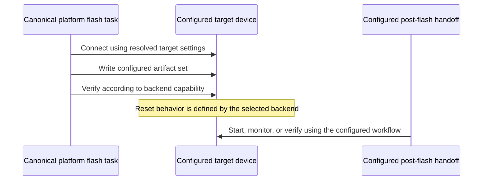

# Platform-Independent Flashing

This skill defines shared orchestration and safety rules for firmware flashing
across supported targets. It is not a vendor-tool manual. Resolve target,
geometry, artifacts, connection settings, and device-specific behavior through
the project SSoT and the selected toolchain. Follow the relevant backend skill
for vendor-specific requirements.

## 1. No platform-specific literals in shared guidance

Do not hard-code target names, port paths, flash capacities, offsets, partition
or artifact names, group names, image paths, SDK locations, activation scripts,
vendor commands, or reset flags in shared task/toolchain implementation. Define
values in the canonical project configuration and consume them through its
resolved configuration or toolchain hooks. Any current-project command recipe
in this skill must be explicitly labeled as such and must not be treated as a
cross-platform default.

Use the platform-neutral Invoke interface rather than calling vendor flashing
tools directly:

```bash
inv es.platform.flash
```

Resolve the default target and connection from configuration. If an explicit
target or port is required, confirm it against the active configuration and
intended device before use.

## 2. Source of truth and generated artifacts

Use the project configuration as the source of truth for flash geometry and
image selection. In this repository, the shared layout is under
`flash_layout`:

- `flash_layout.partitions` describes configured physical partition geometry.
- `flash_layout.artifacts` maps configured artifact identifiers to image kinds,
  canonical `{paths.*}` values, and any required metadata.
- `flash_layout.groups` defines named sets of configured artifact identifiers.
- Generated partition maps, build metadata, and binaries must come from their
  canonical generation/build tasks. Never hand-edit generated output.

Treat identifiers and group membership as configuration data. Do not copy
literal values from a current target into shared instructions or code. Child
configurations must inherit shared values rather than duplicate or
self-reference them.

## 3. Configured artifact flashing

When the active task and backend support artifact selection, use configured
identifiers rather than literal target-specific image names:

```bash
# Normal backend flash behavior
inv es.platform.flash

# One configured artifact
inv es.platform.flash --partitions='<configured-artifact>'

# Multiple configured artifacts
inv es.platform.flash --partitions='<artifact-a>,<artifact-b>'

# One configured artifact group
inv es.platform.flash --group='<configured-group>'
```

The selection and group options are mutually exclusive. Quote comma-separated
values as needed by the shell. If selection is not supported by the active
backend, do not bypass the task or fall back to an ad hoc vendor command.

Selected flashing should validate all configured inputs before serial/device
access. At minimum, verify that:

- Every requested artifact and group member exists in the resolved
  configuration.
- Generated layout and tool metadata agree with the active SSoT.
- Image files exist, are non-empty, and fit their configured regions.
- Offsets and erase/alignment regions are in bounds and do not overlap.
- Any security-related image format is supported by the selected backend and
  matches the configured security mode.

Reject unknown or duplicate identifiers, stale generated data, invalid
geometry, and oversized images before issuing a write. Selected writes should
use validated command settings; do not pass arbitrary options that can
override destinations, reset behavior, or security settings.

## 4. Safe operation sequence

Hardware flashing and erasing are destructive. Before starting:

1. Confirm explicit authorization, the intended target, and its configured or
   explicitly selected connection.
2. Confirm exclusive ownership of the device connection; close other monitors
   or serial tools.
3. Generate configuration and image inputs using the canonical project tasks.
4. Build using the platform task and resolve provisioning requirements from
   the active workflow. Provision only when the configured operation requires
   it.
5. Flash using the configured artifact or group selection, or the normal
   backend flash behavior.
6. Follow the backend's documented reset and monitor handoff. Do not insert an
   unplanned reset, power cycle, or competing connection between stages.
7. Verify both the expected flash contents and successful application startup
   when the workflow requires those checks.

An erase task clears device contents and must not be included automatically in
a build/flash sequence. Require explicit authorization for it. Never run HIL or
physical-device flashing merely to validate code or documentation.

### Current repository factory flash chain

This is the complete integration sequence for the current root project, not a
platform-independent default. Run it from the project root, after confirming
the active activation script and configured group in the project configuration.
Close other serial sessions first. The erase stage is destructive and requires
explicit hardware authorization and a confirmed target/port.

```bash
source activate_esp-5.4-matter_1.4.2.sh

inv es.platform.erase &&
inv es.build-config.all &&
inv es.platform.build &&
inv es.crypto.provision-nvs &&
inv es.crypto.verify-nvs &&
inv es.platform.flash --group=factory &&
inv es.platform.monitor
```

In this project, the configured factory group combines the firmware and
provisioned data images into one selected-flash operation, replacing a
separate NVS image flash step. Keep the group membership SSoT-driven. The
selected-flash operation verifies its writes and leaves reset/boot handoff to
the configured monitor workflow. Do not reset, power-cycle, or start another
serial tool between flashing and that handoff.

## 5. Security and provisioning boundaries

- Distinguish storage-layer encryption from physical flash encryption; one does
  not imply or provide the other.
- A simulation or virtual security state is not evidence that physical
  encryption is enabled or correctly provisioned.
- Do not synthesize encrypted images, key blocks, checksums, or security
  metadata. Use the canonical generator and verifier for the configured
  backend.
- Do not change security configuration, burn eFuses, or perform irreversible
  key provisioning without explicit authorization and the applicable
  hardware-security guidance.
- If an artifact's encryption mode or format is ambiguous, stop before
  flashing and resolve it using the active configuration and
  `hardware-security-crypto-integrity/SKILL.md`.

## 6. Backend-specific behavior and evidence

Reset handling, no-reset options, SDK discovery, parser selection, baud rates,
image containers, and readback capabilities differ by platform. Keep those
details in the relevant backend implementation/configuration and its specific
guidance. Do not copy a backend-specific command or flag into this shared skill.

A dry run validates only the generated command path; it does not prove that a
physical target was flashed or booted. Do not claim a hardware fix from a
successful build or pre-boot readback alone. When unexplained corruption or
boot failure occurs, preserve the observations, distinguish confirmed facts
from hypotheses, and verify post-boot behavior.

## 7. Generic flash handoff


