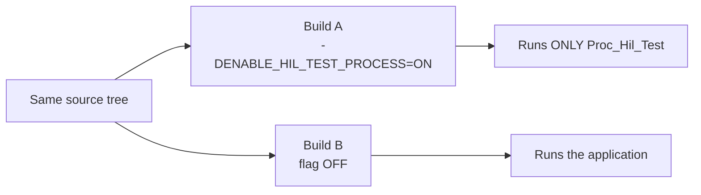
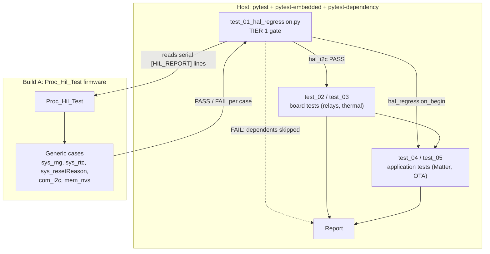

# HIL test structure (two tiers)

## Idea in one minute

- **Tier 1 (generic HAL):** the same test firmware runs on any board. It executes the generic HAL contract cases and prints `[HIL_REPORT]` lines. pytest reads them and gates the run.
- **Tier 2 (application):** board-specific and application pytests run only if Tier 1 passed.
- **Host:** pytest with `pytest-embedded` (serial/flash) and `pytest-dependency` (tier ordering). No per-platform test library is needed.

## Folder layout

```
embedded_system/Tests/hil/cases/     firmware  generic contract cases (pure C++, no pins)
main/Proc_Hil_Test.{hpp,cpp}         firmware  runs the cases, prints [HIL_REPORT]
CI_CD/tests/hil/conftest.py          host      pytest-embedded fixtures
CI_CD/tests/hil/suites/              host      test_01..05 (tiers 1 and 2)
```

## Two firmware builds



## Run flow



Each board test declares its Tier 1 prerequisite through `pytest-dependency`. For example, the relay test needs `hal_i2c`. If that node fails, the dependent test is skipped and the report shows why.

## Caveats

- **Flashing needs explicit authorization.** Run `inv es.ci-cd.hil` only with hardware confirmed ready.
- **Stage 2 log checks** (`Proc_PowerSwitchEventManager: initialized`) need Build B with `TEST_MODE` commented out in `main/main.cpp:15`. With `TEST_MODE` defined, the app runs `Proc_AppTest_Ota` and that process is never built.
- **Thermal check** is skipped for now. `Proc_ThermalMonitor` is not constructed in production.
- **io_gpio loopback** is skipped. No second free GPIO is wired on the board.

## Industry context (general knowledge, not checked online)

| Need | Common tools | This repo |
|---|---|---|
| On-target unit tests | Unity + Ceedling, ESP-IDF unit-test app, Zephyr ztest | Generic cases run by `Proc_Hil_Test` |
| Host orchestration | pytest + pytest-embedded, Robot Framework, LAVA | pytest + pytest-embedded |
| Ordering / gating | pytest-dependency, DAG runners | pytest-dependency |
| CI | Self-hosted runner per bench, manual approval before flashing | `inv es.ci-cd.hil`, flashing needs authorization |
