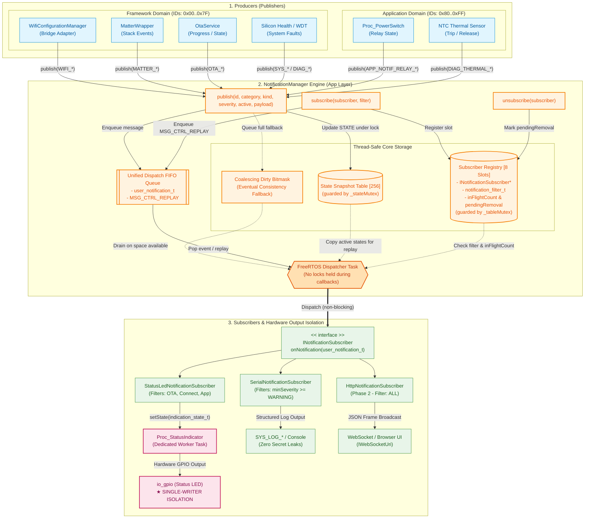
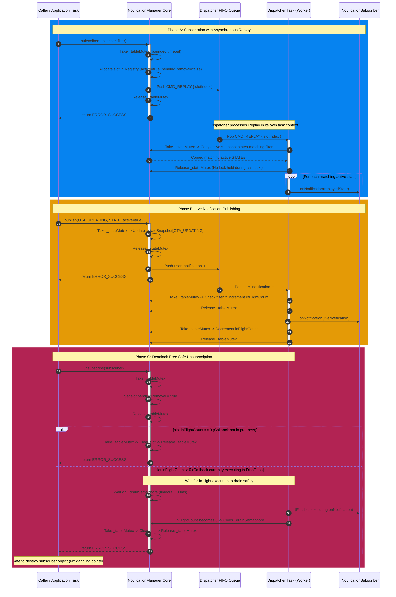

Here are the Mermaid diagrams representing the **User Notification Manager**:

1. **System Architecture & Data Flow Diagram** (Structure, thread boundaries, and hardware single-writer isolation).
2. **Lifecycle & Thread-Safe Synchronization Sequence Diagram** (Publishing, asynchronous replay on subscription, and deadlock-free unsubscription).

---

### 1. System Architecture & Component Decoupling

---

### 2. Runtime Flow: Asynchronous Replay & Deadlock-Free Drain Sequence

